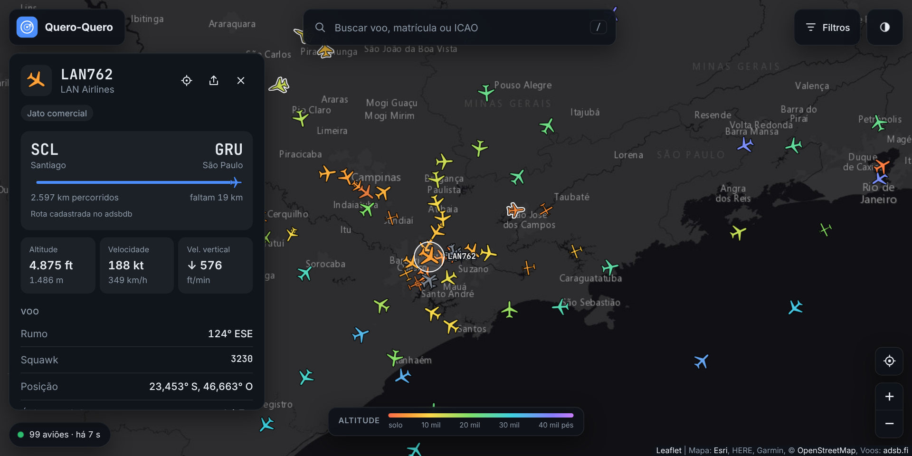
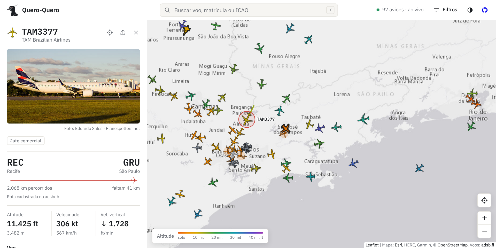
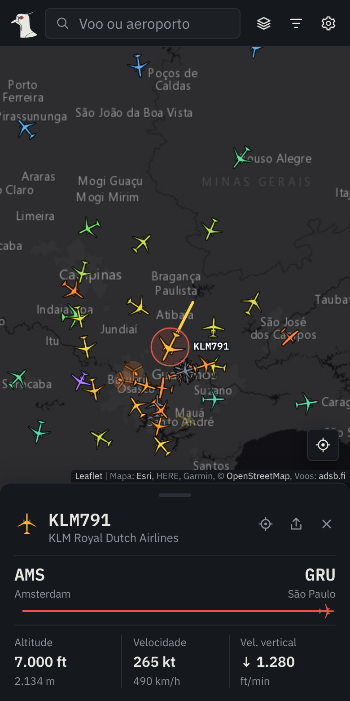

<div align="center">

# ✈️ Quero-Quero

Rastreador de voos em tempo real feito com **HTML, CSS e JavaScript puros**: aviões no mapa com rumo, altitude, velocidade, rastro e rota, sem framework e sem etapa de build.



<br><br>

[](https://erickfuzer.github.io/QueroQuero/)

</div>

## Funcionalidades

- **Aviões em tempo real** girando conforme o rumo e atualizados a cada 10 s, com **movimento suave** entre uma atualização e outra
- **Ícone por tipo de aeronave**, com silhuetas desenhadas para o projeto:
  - jato comercial (A320, 737), grande porte bimotor (A330, 777, 787) e quadrimotor (747, A380)
  - regional turboélice (ATR, Dash 8), jato executivo e aviação leve (Cessna, Piper)
  - helicóptero civil e militar (Black Hawk), com o rotor girando
  - caça com a silhueta do **F-39 Gripen** e transporte militar com a do **KC-390**, em homenagem à aviação brasileira
  - planador, drone, balão e veículo em solo
  - **militares** ganham um contorno de destaque
- **Tema claro e escuro** na interface, seguindo o sistema por padrão
- **Seletor de mapa:** escuro, claro, satélite, relevo e ruas, independente do tema da interface
- **Camadas:** radar de chuva das últimas 2 horas (com animação), aeroportos, sombra de dia e noite e rastro de todos os aviões
- **Aeroportos:** clique num aeroporto (ou busque por "GRU", "Guarulhos") para ver os voos chegando e saindo na área do mapa
- **Painel do voo:** indicativo, companhia, tipo, altitude, velocidade, velocidade vertical, rumo, squawk (com alerta de emergência), posição, matrícula, modelo, código ICAO e país de registro
- **Rota com progresso:** origem, destino, quanto já foi percorrido e quanto falta, quando a rota está cadastrada no adsbdb e confere com a posição do avião; quando não há rota confiável, o painel diz isso em vez de inventar
- **Foto da aeronave** no painel, do Planespotters.net, com o crédito do fotógrafo
- **Rastro recente** desenhado no mapa, colorido pela altitude de cada trecho
- **Seguir:** o mapa acompanha o avião selecionado
- **Compartilhar:** gera um link que abre o mapa já com o voo selecionado
- **Busca** por indicativo, matrícula, código ICAO ou aeroporto, com sugestões e atalho <kbd>/</kbd>
- **Filtros** por tipo de aeronave, companhia, situação (no ar ou em solo) e altitude, com atalhos para só militares, só helicópteros e emergências
- **Preferências:** unidades (pés ou metros, nós ou km/h) e nomes dos voos no mapa, lembradas pelo navegador
- **Relógio UTC (Zulu)** na barra, o horário usado na aviação
- **Sua localização** no início (com permissão) e no botão de mira; sem ela, o mapa abre sobre São Paulo
- **Avisos amigáveis** quando o limite gratuito estoura ou a fonte de dados falha, com nova tentativa automática
- **Economia:** busca só a área visível do mapa, só refaz a busca quando a área muda de verdade e pausa tudo quando a aba fica oculta
- **Celular:** o painel vira uma folha inferior; arraste para cima para ver tudo, para baixo para recolher ou fechar

<details>
<summary>Ver no tema claro e no celular</summary>
<br>

<br><br>

</details>

## Como funciona

- **Dados:** as APIs gratuitas de ADS-B (adsb.fi, airplanes.live, adsb.lol, OpenSky) não liberam CORS, então o navegador não consegue lê-las direto de uma página no GitHub Pages. Um proxy pequeno no **Cloudflare Workers** (`proxy/worker.js`, plano gratuito) faz a consulta, tenta as fontes em sequência e devolve só os campos usados, já com os cabeçalhos de CORS.
- **Área visível:** as APIs consultam por raio, então o app calcula o círculo que cobre o mapa na tela (até 250 milhas náuticas). Ao arrastar ou dar zoom, só busca de novo se o centro andou mais de um quarto do raio ou o zoom mudou o raio, e no máximo uma vez a cada 3 s.
- **Desenho:** os aviões são desenhados num `<canvas>` por cima do Leaflet, o que mantém a animação leve mesmo com centenas de aeronaves. Cada silhueta é um traçado SVG gerado a partir das medidas reais do modelo (comprimento, envergadura, fuselagem e motores) e unido num contorno único; o mesmo traçado é usado no canvas (`Path2D`) e nos ícones da interface. Os nomes dos voos que cairiam um em cima do outro são pulados.
- **Tipo de aeronave:** vem da categoria que o próprio transponder informa (A1 leve, A3 comercial, A5 grande porte, A7 helicóptero, B6 drone…). O modelo (designador ICAO, como `B744`, `AT76` ou `C130`) refina a escolha: quadrimotores, turboélices regionais, transportes militares e helicópteros militares. Quando a categoria não vem, o app tenta pelo modelo e pelo fabricante. A marcação de militar vem da base de aeronaves das redes de receptores.
- **Interpolação:** cada quadro estima a posição por `velocidade × tempo` no rumo atual, sem arredondar para o pixel. Quando chega um dado novo, a diferença entre o que estava na tela e a posição real some ao longo de 1,5 s.
- **Rastro:** as APIs gratuitas não entregam o histórico do voo, então o app guarda as posições recebidas desde que a página foi aberta (até cerca de 1 hora por avião).
- **País de registro:** sai do endereço ICAO de 24 bits do transponder, pelas faixas que a ICAO reserva para cada país (o Brasil vai de `E40000` a `E7FFFF`).
- **Radar de chuva:** quadros de 10 em 10 minutos do RainViewer, sobrepostos ao mapa e atualizados sozinhos.
- **Dia e noite:** a linha que separa o dia da noite é calculada no navegador a partir da posição do Sol, sem API.
- **Aeroportos:** uma base enxuta dos ~3.300 aeroportos médios e grandes com voo regular do OurAirports (`assets/dados/aeroportos.json`), carregada só quando usada. Chegadas e partidas são os voos da área cuja rota cadastrada liga ao aeroporto e confere com a posição.
- **Rota:** vem do adsbdb pelo indicativo. Como a base é colaborativa e às vezes está velha, o app só mostra a rota se o avião estiver num caminho plausível entre origem e destino. O progresso é a distância já voada sobre a soma da voada com a que falta.

## Como usar

**Online:** acesse **[erickfuzer.github.io/QueroQuero](https://erickfuzer.github.io/QueroQuero/)**.

**No seu computador:** baixe o repositório pelo botão **Code → Download ZIP**, extraia e abra o `index.html` no navegador. Não precisa instalar nada.

Se preferir usar o Git:

```bash
git clone https://github.com/erickfuzer/QueroQuero.git
```

A versão online e a cópia aberta direto do `index.html` usam o proxy do projeto, então funcionam sem configurar nada.

### Publicando o seu próprio proxy

Só é preciso se você publicar a sua cópia em outro endereço (um fork no seu GitHub Pages, por exemplo), porque o proxy do projeto só atende o endereço oficial, `localhost` e o arquivo aberto do disco. É gratuito (100 mil requisições por dia) e leva uns 2 minutos:

1. Crie uma conta em [dash.cloudflare.com](https://dash.cloudflare.com) e escolha um subdomínio para o `workers.dev` (o nome é seu, por exemplo o seu usuário)
2. Vá em **Workers & Pages → Create → Worker**, dê um nome (por exemplo `queroquero`) e clique em **Deploy**
3. Clique em **Edit code**, cole o conteúdo de `proxy/worker.js`, acrescente o endereço do seu site em `ORIGENS` (por exemplo `'https://seu-usuario.github.io'`) e clique em **Deploy** de novo
4. No início do `script.js`, troque `proxy` pelo endereço do seu Worker, que fica assim: `https://queroquero.seu-subdominio.workers.dev`

Para testar um proxy sem mexer no código, passe o endereço pela URL: `index.html?proxy=https://queroquero.seu-subdominio.workers.dev`.

Sempre que o `proxy/worker.js` mudar no repositório, cole a versão nova no Worker para ele ficar igual.

## Estrutura

```
QueroQuero/
├── index.html        # estrutura da página, painel, filtros e legenda
├── style.css         # temas claro e escuro, painel, folha inferior e versão mobile
├── script.js         # mapa, dados, interpolação, ícones por tipo, painel, busca, filtros e tema
├── proxy/
│   └── worker.js     # proxy para o Cloudflare Workers (CORS, fontes e cache)
├── assets/
│   ├── logo/         # rosto do quero-quero em SVG (colorido, claro e escuro) e o gerador
│   ├── dados/        # aeroportos.json, extraído do OurAirports
│   └── *.png         # prints do README e da prévia de link
├── LICENSE
└── README.md
```

## Créditos

- Dados de voo: [adsb.fi](https://adsb.fi), com [airplanes.live](https://airplanes.live) e [adsb.lol](https://adsb.lol) como reserva, todos mantidos por redes de receptores voluntários
- Rotas e companhias: [adsbdb](https://www.adsbdb.com)
- Fotos das aeronaves: [Planespotters.net](https://www.planespotters.net), com o crédito de cada fotógrafo no painel
- Logotipo: rosto do quero-quero desenhado para o projeto a partir de uma foto de referência
- Radar de chuva: [RainViewer](https://www.rainviewer.com)
- Aeroportos: [OurAirports](https://ourairports.com) (domínio público)
- Mapa interativo: [Leaflet](https://leafletjs.com)
- Mapas base: Esri Dark Gray, Light Gray, World Imagery, World Topo e World Street ([Esri](https://www.esri.com), HERE, Garmin, © [colaboradores do OpenStreetMap](https://www.openstreetmap.org/copyright) e comunidade de usuários de SIG)

Desenvolvido com o auxílio do [Claude](https://claude.ai) (Anthropic) na escolha das fontes de dados, no proxy, na interpolação dos aviões, nos ícones por tipo e no redesenho da interface.

## Licença

[MIT](LICENSE): use, modifique e distribua à vontade.

<div align="center">
<sub>Feito por <a href="https://github.com/erickfuzer">Erick Fuzer</a></sub>
</div>
