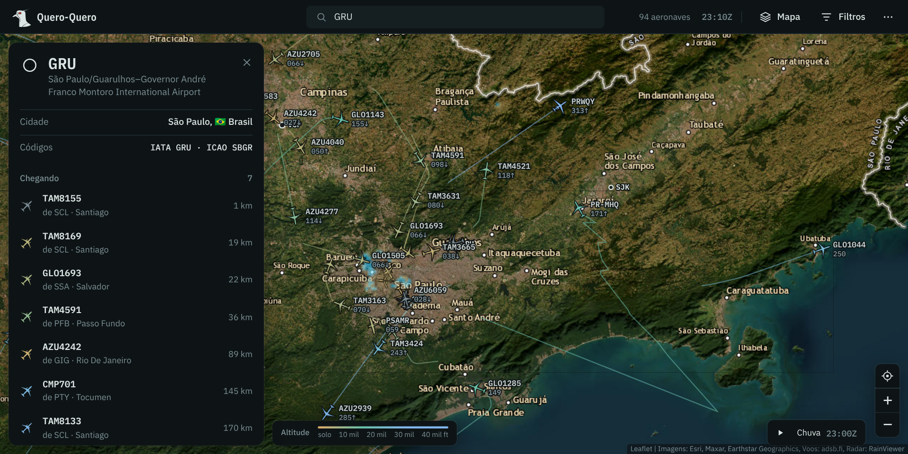

<div align="center">

# ✈️ Quero-Quero

Rastreador de voos em tempo real feito com **HTML, CSS e JavaScript puros**: aviões no mapa com rumo, altitude, velocidade, rastro e rota, sem framework e sem etapa de build.


<br><br>

[](https://erickfuzer.github.io/QueroQuero/)

</div>

## Funcionalidades

**No mapa**
- Aviões em tempo real, atualizados a cada 10 s e com **movimento suave** entre uma atualização e outra
- **Ícone por tipo de aeronave**, com silhuetas desenhadas para o projeto: jato comercial, grande porte, quadrimotor, regional turboélice, executivo, aviação leve, helicópteros, planador, drone e balão. O caça tem a silhueta do **F-39 Gripen** e o transporte militar a do **KC-390**, em homenagem à aviação brasileira; **militares** ganham um contorno de destaque
- Cor pela altitude, com legenda, e o **rastro** do voo selecionado colorido trecho a trecho
- **Cinco mapas:** escuro, claro, satélite, relevo e ruas, independentes do tema da interface
- **Camadas:** radar de chuva das últimas 2 horas (com animação), aeroportos, sombra de dia e noite e rastro de todas as aeronaves

**No cartão do voo**
- Cartão flutuante sobre o mapa com indicativo, companhia, modelo, altitude, velocidade, velocidade vertical, rumo, squawk (com alerta de emergência), posição, matrícula, modelo, código ICAO e país de registro
- **Foto da aeronave**, do Planespotters.net, com o crédito do fotógrafo
- **Rota com progresso:** origem, destino, quanto já foi voado e quanto falta, só quando a rota cadastrada confere com a posição do avião; se não confere, o cartão diz isso em vez de inventar
- **Seguir**, para o mapa acompanhar o avião, e **compartilhar**, com um link que abre o mapa já no voo

**Aeroportos**
- Clique num aeroporto, ou busque por "GRU" ou "Guarulhos", para ver os voos **chegando e saindo** num raio de 200 km

**Na barra**
- **Busca** por indicativo, matrícula, código ICAO ou aeroporto, com atalho <kbd>/</kbd>
- **Filtros** por tipo, companhia, situação (no ar ou em solo) e altitude, com atalhos para só militares, só helicópteros e emergências
- **Preferências** (no menu ⋯, junto com o Sobre): tema claro ou escuro (segue o sistema por padrão), pés ou metros, nós ou km/h e nomes dos voos no mapa, lembradas pelo navegador
- **Relógio UTC (Zulu)**, o horário usado na aviação, e a contagem de aeronaves na área, que muda de cor quando os dados atrasam ou a conexão cai

**No dia a dia**
- Abre na sua localização (com permissão) ou sobre São Paulo
- Busca só a área visível e pausa quando a aba fica oculta; com o mapa afastado demais, mostra até onde as fontes alcançam
- Avisos claros quando o limite gratuito estoura ou a fonte falha, com nova tentativa automática
- **Celular:** o cartão vira uma folha inferior que se arrasta para cima para ver tudo

<details>
<summary>Ver no satélite, no tema claro e no celular</summary>
<br>

<br><br>

<br><br>

</details>

## Como funciona

- **Dados:** as APIs gratuitas de ADS-B (adsb.fi, airplanes.live, adsb.lol, OpenSky) não liberam CORS, então o navegador não consegue lê-las direto de uma página no GitHub Pages. Um proxy pequeno no **Cloudflare Workers** (`proxy/worker.js`, plano gratuito) faz a consulta, tenta as fontes em sequência e devolve só os campos usados.
- **Área visível:** as APIs consultam por raio, então o app calcula o círculo que cobre o mapa (até 250 milhas náuticas, cerca de 460 km) e só refaz a busca quando a área muda de verdade, no máximo uma vez a cada 3 s.
- **Desenho:** os aviões são desenhados num `<canvas>` por cima do Leaflet, o que mantém a animação leve mesmo com centenas de aeronaves. Cada silhueta é um traçado SVG feito a partir das medidas reais do modelo, usado tanto no canvas (`Path2D`) quanto nos ícones da interface.
- **Interpolação:** cada quadro estima a posição por `velocidade × tempo` no rumo atual. Quando chega um dado novo, a diferença entre o que estava na tela e a posição real some ao longo de 1,5 s, então o avião desliza em vez de pular.
- **Tipo de aeronave:** vem da categoria informada pelo transponder (A1 leve, A3 comercial, A7 helicóptero…), refinada pelo modelo (`B744`, `AT76`, `C130`…). A marcação de militar vem da base das redes de receptores.
- **Rota:** vem do adsbdb pelo indicativo e fica guardada no navegador por um dia. Como a base é colaborativa e às vezes está velha, a rota só aparece se o avião estiver num caminho plausível entre origem e destino.
- **Rastro:** as APIs gratuitas não entregam o histórico do voo, então o app guarda as posições recebidas desde que a página foi aberta (até cerca de 1 hora por avião).
- **País de registro:** sai do endereço ICAO de 24 bits do transponder, pelas faixas que a ICAO reserva para cada país (o Brasil vai de `E40000` a `E7FFFF`).
- **Camadas:** o radar de chuva vem do RainViewer, de 10 em 10 minutos; a linha entre dia e noite é calculada no navegador pela posição do Sol; os aeroportos são uma base enxuta dos ~3.300 médios e grandes com voo regular do OurAirports, carregada só quando usada.

## Como usar

**Online:** acesse **[erickfuzer.github.io/QueroQuero](https://erickfuzer.github.io/QueroQuero/)**.

**No seu computador:** baixe o repositório pelo botão **Code → Download ZIP** e extraia, ou use o Git:

```bash
git clone https://github.com/erickfuzer/QueroQuero.git
```

O código usa módulos JavaScript, que o navegador só carrega a partir de um endereço `http://`. Por isso, em vez de abrir o `index.html` direto, rode um servidor local na pasta do projeto (o Python já vem instalado no Linux e no macOS):

```bash
cd QueroQuero
python3 -m http.server 8000
```

e acesse **http://localhost:8000**. Não precisa instalar mais nada nem compilar.

A versão online e a cópia rodando em `localhost` usam o proxy do projeto, então funcionam sem configurar nada.

### Publicando o seu próprio proxy

Só é preciso se você publicar a sua cópia em outro endereço (um fork no seu GitHub Pages, por exemplo), porque o proxy do projeto só atende o endereço oficial e o `localhost`. É gratuito (100 mil requisições por dia) e leva uns 2 minutos:

1. Crie uma conta em [dash.cloudflare.com](https://dash.cloudflare.com) e escolha um subdomínio para o `workers.dev` (o nome é seu, por exemplo o seu usuário)
2. Vá em **Workers & Pages → Create → Worker**, dê um nome (por exemplo `queroquero`) e clique em **Deploy**
3. Clique em **Edit code**, cole o conteúdo de `proxy/worker.js`, acrescente o endereço do seu site em `ORIGENS` (por exemplo `'https://seu-usuario.github.io'`) e clique em **Deploy** de novo
4. Em `js/config.js`, troque `proxy` pelo endereço do seu Worker, que fica assim: `https://queroquero.seu-subdominio.workers.dev`

Para testar um proxy sem mexer no código, passe o endereço pela URL: `index.html?proxy=https://queroquero.seu-subdominio.workers.dev`.

Sempre que o `proxy/worker.js` mudar no repositório, cole a versão nova no Worker para ele ficar igual.

## Estrutura

```
QueroQuero/
├── index.html               # estrutura da página: navbar, painéis, popovers e janela Sobre
├── style.css                # temas claro e escuro, painéis, folha inferior e versão mobile
├── js/                      # código em módulos ES, sem etapa de build
│   ├── main.js              # ponto de entrada: monta a interface e começa a buscar os voos
│   ├── config.js            # endereço do proxy, intervalos e limites
│   ├── dados.js             # busca periódica no proxy, situação da conexão e alcance
│   ├── estado.js            # aviões recebidos, interpolação e posição exibida
│   ├── desenho.js           # canvas: aviões, rastros, aeroportos, clique e dica do mouse
│   ├── aeronaves.js         # silhuetas, grupos e classificação por tipo
│   ├── cores.js             # cores por altitude conforme o tema e o mapa
│   ├── mapa.js              # mapa Leaflet e estilos de mapa base
│   ├── painel.js            # painel do voo: dados, foto, rota, seguir e compartilhar
│   ├── painel-aeroporto.js  # painel do aeroporto: chegadas e partidas
│   ├── rotas.js             # rotas do adsbdb, com cache no navegador
│   ├── aeroportos.js        # base de aeroportos do OurAirports
│   ├── busca.js             # busca de voos e aeroportos
│   ├── filtros.js           # filtros por tipo, situação, companhia e altitude
│   ├── interface.js         # popovers, preferências, tema, camadas, relógio e atalhos
│   ├── prefs.js             # preferências salvas e unidades
│   ├── companhias.js        # nomes das companhias pelo prefixo do indicativo
│   ├── paises.js            # país de registro pelo código ICAO
│   ├── avisos.js            # avisos no topo da tela
│   └── util.js              # utilitários de DOM, números e distância
├── proxy/
│   └── worker.js            # proxy para o Cloudflare Workers (CORS e fontes)
├── assets/
│   ├── logo/                # rosto do quero-quero em SVG (colorido, claro e escuro) e o gerador
│   ├── dados/               # aeroportos.json, extraído do OurAirports
│   └── *.png                # prints do README e da prévia de link
├── LICENSE
└── README.md
```

## Créditos

- Dados de voo: [adsb.fi](https://adsb.fi), com [airplanes.live](https://airplanes.live) e [adsb.lol](https://adsb.lol) como reserva, todos mantidos por redes de receptores voluntários
- Rotas e companhias: [adsbdb](https://www.adsbdb.com)
- Fotos das aeronaves: [Planespotters.net](https://www.planespotters.net), com o crédito de cada fotógrafo no painel
- Logotipo: rosto do quero-quero desenhado para o projeto a partir de uma foto de referência
- Radar de chuva: [RainViewer](https://www.rainviewer.com)
- Aeroportos: [OurAirports](https://ourairports.com) (domínio público)
- Mapa interativo: [Leaflet](https://leafletjs.com)
- Mapas base: Esri Dark Gray, Light Gray, World Imagery, World Topo e World Street ([Esri](https://www.esri.com), HERE, Garmin, © [colaboradores do OpenStreetMap](https://www.openstreetmap.org/copyright) e comunidade de usuários de SIG)

Desenvolvido com o auxílio do [Claude](https://claude.ai) (Anthropic) na escolha das fontes de dados, no proxy, na interpolação dos aviões, nos ícones por tipo, no redesenho da interface e na organização do código em módulos.

## Licença

[MIT](LICENSE): use, modifique e distribua à vontade.

<div align="center">
<sub>Feito por <a href="https://github.com/erickfuzer">Erick Fuzer</a></sub>
</div>
