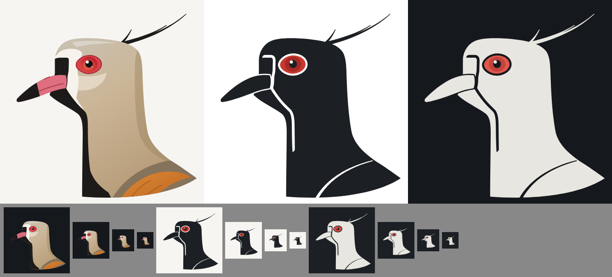

# Rosto do quero-quero

Desenho de perfil traçado sobre uma foto de referência, em três versões SVG (`viewBox="0 0 512 512"`, fundo transparente).



| Arquivo | Uso | Cores |
| --- | --- | --- |
| `quero-quero-colorido.svg` | qualquer fundo | cabeça cinza-areia, máscara preta com borda branca, bico rosado de ponta preta, olho vermelho e ombro bronzeado |
| `quero-quero-claro.svg` | tema claro (fundos claros) | silhueta `#1c1f23`, olho `#c8382f` |
| `quero-quero-escuro.svg` | tema escuro (fundos escuros) | silhueta `#e8e6e1`, olho `#e0574d`, pupila `#15181c` |

As cores das silhuetas são as de `--texto` e `--destaque` de cada tema em `style.css`. Os recortes das silhuetas (borda da máscara, encaixe do bico, linha da asa e volta do olho) são vazados e mostram o fundo.

Cada arquivo usa ids próprios (`qq-…-colorido`, `qq-…-claro`, `qq-…-escuro`), então dá para embutir mais de uma versão na mesma página.

## Ajustes

Os três arquivos saem do `gerar.js`, que guarda a geometria em pixels da foto de referência. Para mudar uma parte, edite a geometria e gere de novo:

```bash
node assets/logo/gerar.js assets/logo
```
